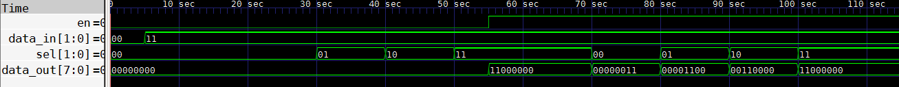
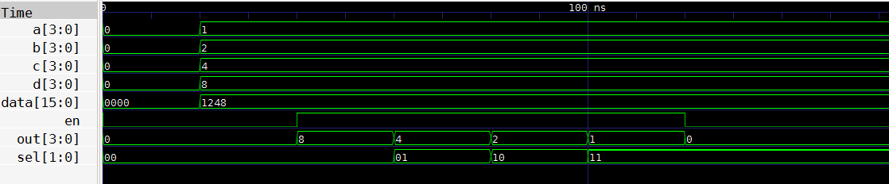

# Plexors
## demux
### Description
`demux` is a parameterized demultiplexor with dynamic `WIDTH` and `SELECT` bits.

---

### Using the Module

#### Parameters
| Parameter | Default | Description |
| :--- | :--- | :--- |
| `WIDTH` | `4` | Defines bitwidth of input and outputs |
| `SELECT` | `1` | Defines how many select lines there are, outputs would be defined as `2^SELECT` |

#### Inputs
| Port | Bitwidth | Description |
| :--- | :---: | :--- |
| `data_in` | `WIDTH` | Data line(s) that get routed to `data_out` determined by `sel`  |
| `sel` | `SELECT` | Binary input that determines which output `data_in` gets routed to |
| `en` | `1` | Enables output lines when `HIGH`, when `LOW` all outputs are `0` | 

#### Outputs
| Port | Fan Out | Bitwidth | Description |
| :--- | :---: | :--- |
| `data_out` | `2^SELECT` | `WIDTH` | Two Dimensional output lines defined as `2^SELECT` by `WIDTH`, output `sel` will recieve `data_in` value when `en` is `HIGH` |

#### Notes
* 

---

### Instantiation Example
```SystemVerilog
demux #(
    .WIDTH      (4), #each output is 4-bits wide
    .SELECT     (2) #four possible outputs
)uut(
    .data_in    (data_in),
    .sel        (sel),
    .en         (en),
    .data_out   (data_out)
);
```

### Timing Diagram


*Figure 1: `demux` (WIDTH = 2, SELECT = 2) testing each `sel` value for proper value and enable*


---

## mux
### Description
`mux` is a parameterized multiplexor with dynamic `WIDTH` and `SELECT` bits.

---

### Using the Module

#### Parameters
| Parameter | Default | Description |
| :--- | :--- | :--- |
| `WIDTH` | `4` | Defines bitwidth of input and outputs |
| `SELECT` | `1` | Defines how many select lines there are, inputs would be defined as `2^SELECT` |

#### Inputs
| Port | Fan Out | Bitwidth | Description |
| :--- | :---: | :--- |
| `data_in` | `SELECT` | `WIDTH` | Data lines that get routed to `data_out`  |
| `sel` | `N/A` | `SELECT` | Binary input that determines which input gets routed to `data_out` |
| `en` | `1` | Enables `data` when `HIGH`, when `LOW` `data_out` is `0` | 

#### Outputs
| Port | Bitwidth | Description |
| :--- | :---: | :--- |
| `data_out` | `WIDTH` | Outputs selected `data_in` line when `en` is `HIGH` |

#### Notes
* 

---

### Instantiation Example
```SystemVerilog
mux #(
    .WIDTH      (4), #each input is 4-bits wide
    .SELECT     (2) #four possible inputs
)uut(
    .data_in    (data_in),
    .sel        (sel),
    .en         (en),
    .data_out   (data_out)
);
```

### Timing Diagram


*Figure 1: `demux` (WIDTH = 2, SELECT = 2) testing each `sel` value for proper value and enable*


---